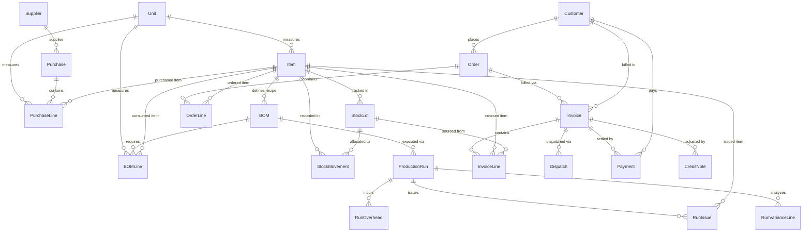

# Snack Ledger — Technical Design Note

---

## 1. Data Model & Architecture

The architecture separates core inventory tracking, recipe-based production, and order-to-cash sales into distinct modular domains connected through foreign keys and ledger references.



---

## 2. Stock & BOM Consumption from the StockMovement Ledger

### Dynamic Stock Computation
Stock levels are never stored as static numbers in tables. All balances are derived dynamically from the `StockMovement` table:

$$\text{Item Balance} = \sum \text{StockMovement.qty}$$

- **Positive quantities:** Inward stock (opening balances, supplier purchase receipts, finished goods production output).
- **Negative quantities:** Outward stock (raw materials/packaging issued to production, customer sales dispatches).
- **Immutability Guarantee:** Once written, `StockMovement` records cannot be updated or deleted. Any modification attempt via model methods or QuerySets raises an `ImmutableStockMovementError`. Cancellations create compensating entries with `source_type='reversal_...'`.

### BOM Consumption & Production Runs
1. **Planned vs. Actual:** A `BOM` specifies standard ingredient quantities per batch. For a run of $N$ batches, planned material is $\text{qty\_per\_batch} \times N$.
2. **Issue Capture:** Actual raw material issues are recorded via `RunIssue`. Actual packaging usage is calculated dynamically as $\text{actual\_good\_output} + \text{damaged\_pouches}$ for pouches, and $\text{cartons\_used}$ for cartons.
3. **Atomic Run Posting (`post_run`):**
   - Consumes raw materials and packaging using `issue_stock` (FIFO), creating negative `StockMovement` records linked to the run.
   - Calculates batch material cost from the consumed lot rates.
   - Posts good output packets into finished goods inventory via `receive_stock`, creating a new `StockLot` with a batch number and calculated expiry date.
   - Generates `RunVarianceLine` entries comparing planned vs. actual quantities:
     $$\text{Variance \%} = \frac{\text{Actual} - \text{Planned}}{\text{Planned}} \times 100$$
     If $|\text{Variance \%}| > \text{BOM.tolerance\_percent}$, the line is flagged.
   - Evaluates batch yield variance against $\text{BOM.batch\_yield} \times N$.

---

## 3. FIFO & FEFO Stock Allocation

Stock allocation occurs atomically within database transactions using `select_for_update()` to prevent race conditions during concurrent production or dispatch operations.

```
[issue_stock(item, qty, method)]
        │
        ├──> Acquire row-level lock on all StockLot records for Item (select_for_update)
        │
        ├──> Calculate available balance per lot: SUM(StockMovement.qty WHERE lot=lot)
        │
        ├──> Sort Lots:
        │       • method == "fifo": ORDER BY lot.received_date ASC
        │       • method == "fefo": ORDER BY lot.expiry_date ASC (nulls last)
        │
        ├──> Verify total available >= requested qty (else abort & raise InsufficientStock)
        │
        └──> Loop through sorted lots:
                • Take min(lot_balance, remaining_qty)
                • Create negative StockMovement for this lot
                • Accumulate lot cost = round_half_up(taken_qty * lot.unit_cost_paise)
```

- **FIFO (Raw Materials & Packaging):** Oldest stock is consumed first in production to minimise material degradation on the factory floor.
- **FEFO (Finished Goods Dispatch):** Invoices are dispatched by picking finished goods lots with the earliest expiry dates, preventing aged inventory from remaining in the warehouse.

---

## 4. Costing & Overhead Calculation

All monetary values are stored and calculated as 64-bit integer paise (1 INR = 100 paise) to eliminate floating-point rounding errors.

### Batch Costing Formulae
1. **Material Cost:** As raw materials and packaging lots are consumed via FIFO, their purchase rates are accumulated:
   $$\text{material\_cost\_paise} = \sum (\text{consumed\_qty} \times \text{lot.unit\_cost\_paise})$$
   *Packaging loss rule:* The cost of damaged pouches is included in the batch material cost and absorbed by the good packets produced.
2. **Overhead Cost:** Labour, power, fuel, and other batch expenses are logged as `RunOverhead` rows:
   $$\text{overhead\_cost\_paise} = \sum \text{RunOverhead.amount\_paise}$$
3. **Total Production Cost:**
   $$\text{total\_cost\_paise} = \text{material\_cost\_paise} + \text{overhead\_cost\_paise}$$
4. **Per-Packet Cost:** Overhead and material costs are allocated equally per good packet produced:
   $$\text{cost\_per\_packet\_paise} = \text{round}\left(\frac{\text{total\_cost\_paise}}{\text{actual\_good\_output}}\right)$$
5. **Gross Margin:**
   $$\text{margin\_paise} = \text{selling\_price\_paise} - \text{cost\_per\_packet\_paise}$$

---

## 5. Roles & Audit Logging

### Role-Based Access Control (RBAC)
User permissions are enforced using Django's built-in `auth.Group` structure with five designated roles:

| Role | Permitted Workflows | Restricted From |
|---|---|---|
| **Salesman** | Order entry, order history, customer list | Price edits, order approvals, production runs, financial reports |
| **Admin** | Order approval/rejection, GST invoicing, dispatch, payments | Recipe modification, raw material posting |
| **Production** | Purchase receipts, BOM management, production runs, costing | Invoicing, payment capture, customer management |
| **Accountant** | Read-only access to sales, GST, purchase, stock, and collection reports | Transaction creation, order editing, production posting |
| **Owner** | Full dashboard visibility, KPI monitoring, benchmark verification | Restricted operational views streamlined to summary cards |

Access is secured using the view-level `@role_required(*group_names)` decorator, which returns an HTTP 403 Forbidden response on unauthorized access attempts.

### Audit Logging & Non-Destructive Integrity
- **Audit Trail:** Critical business actions (`post_run`, `create_invoice`, `dispatch_invoice`, `cancel_invoice`, `record_payment`) record an entry in `AuditLog` containing the actor `user_id`, `action`, `model_name`, `object_id`, timestamp, and a JSON payload capturing key state changes.
- **Invoice Cancellation Integrity:** Invoices are never deleted from the database. When an invoice is cancelled via `cancel_invoice`:
  1. A formal `CreditNote` is generated with matching taxable and tax amounts.
  2. Compensating reverse stock movements (`source_type='reversal_invoice'`) are appended to return dispatched stock to inventory.
  3. Associated dispatches are updated to `cancelled`.
  4. The invoice status is updated to `cancelled`, preserving unbroken numbering and a complete audit trail.
